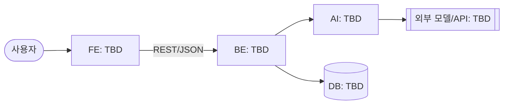

# 요구사항 명세 (SRS)

> 팀이 합의한 "무엇을 만드는가"이자 개발의 기준선. 유즈케이스(UC)에서 기능 요구사항(FR)을 뽑고, FR에서 데모 시나리오와 task를 뽑아 개발을 진행한다.
> ID는 커밋·PR·task 파일이 참조하므로 한 번 붙이면 바꾸지 않는다 (삭제는 ~~취소선~~ + 사유). 번호가 비는 것은 삭제의 흔적이지 누락이 아니다.
> 대회 규칙과 배점은 [`hackathon.md`](hackathon.md), 모듈별 상세 설계는 [`design/`](design/README.md). 이 문서는 팀 합의 후에만 바꾼다.

- **상태**: 초안 / 합의됨 (YYYY-MM-DD)
- **프로젝트명**: TBD
- **한 줄 소개**: TBD — "누가 / 무엇 때문에 / 어떻게 나아지는가"가 한 문장에 들어가야 한다.

| 종류 | 형식 | 예 |
| --- | --- | --- |
| 유즈케이스 | `UC-NN` | `UC-01` |
| 기능 요구사항 | `FR-<UC 번호>-<순번>` | `FR-01-02` (UC-01의 두 번째 요구사항) |
| 비기능 요구사항 | `NFR-<분류>-<순번>` | `NFR-PER-01` |

NFR 분류: `PER` 성능 · `SEC` 보안 · `REL` 신뢰성 · `USA` 사용성 · `OPS` 배포·운영

## 1. 개요

### 1.1 문제와 대상 사용자

- **누구**: 클라우드 비용 과금? 없이 유지하고 싶은 학생, 프로젝트 과목이 끝나도 배포 상태를 유지하고 싶은 학생
- **지금 하는 방식**: Vercel, AWS, Cloudflare 등으로 직접 배포 및 비용 부담

| 문제 | 근거 (숫자 · 인터뷰 · 기사 · 직접 관찰) | 출처 |
| --- | --- | --- |
| 크레딧이 아깝다 | | 구글폼 설문조사(학과 대상) |
| 학교 컴퓨팅 자원이 남는다 | 수업 시간 / 24시간 으로 실제로 어느 비율만 사용한다. 그리고 그 시간에서도 n%의 학생만 개인 노트북이 아닌 학교 컴퓨팅 자원을 사용한다. | 직접 체크 |

근거 출처는 [`ai-scope.md`](ai-scope.md) §4에도 올린다 (발표 부록).

### 1.2 해결 방법

- 학교 남는 컴퓨팅 자원을 클러스터로 묶어서 클라우드 서비스를 제공한다.
- AI로 배포 전 검사 및 운영 중 모니터링 서비스를 제공한다.

### 1.3 AI 동료의 역할 경계

주제 "AI는 동료가 될 수 있을까?"에 대한 우리 답. **AI가 하는 일과 사람이 결정하는 일**을 가른다.

| 상황 | AI가 하는 일 | 사람이 하는 일 / 결정 | 상태 |
| --- | --- | --- | --- |
| 배포 전 취약 사항 검토 | 배포 대상 파일의 보안 검사 후 1차 분석 결과 안내 | 1차 분석 결과 기반으로 수정 혹은 1차 분석에 대해 반박 후 배포 진행 | |
| 모니터링 지표 이상 발생 | 감지 후 1차 분석 결과 안내 및 알림 전송 | 알림 확인 후 2차 조치를 진행한다. | 확정 |
| 정적 호스팅이 필요하다 | Cloudflare R2로 보낸다 | | 보류 |
| 동적 호스팅이 필요하다 | 학교 컴퓨터로 보낸다 | | 보류 |
| (시간남으면 추가)동적 호스팅이 필요한데 학교 컴퓨터가 다운되어 있다 | 클라우드 vm으로 보낸다 | | 보류 |

### 1.4 이미 있는 것과의 차이

| 이미 있는 것 | 한계 | 우리는 |
| --- | --- | --- |
| AWS, vercel, CloudFlare | 무료 크레딧 제한 | 학교 컴퓨팅 자원으로 서비스하여 조금 저렴..? 학생에게 공짜? |

### 1.5 범위

MVP 범위: 개발 마감([대회 일정](hackathon.md))까지 개발 완료할 내용들

- 학교 컴퓨터 혹은 개인 컴퓨터로 사용자의 빌드 파일 실행이 가능하다.
- 하나의 물리적 기기에는 하나의 프로그램만 실행한다.
- 페일오버는 다른 컴퓨터에 있는 레플리카로 재실행 정도만 구현한다.
- 리더 노드와 통신하고 사용자 웹과 통신하는 서버가 존재한다.
- 사용자 통신 서버는 리더 노드와도 통신한다.

### 1.6 범위 밖

만들지 않기로 한 것과 이유. 심사 Q&A에서 "왜 이건 없나요?"에 대한 답이 된다. 만들 것은 §3 UC가 정의한다. MVP 개발 기준 Non-Goal

- 프로덕션 수준의 페일오버를 요구하지 않는다.
- leader 사망 시 교체는 구현하지 않는다.
- 본 시스템은 24시간 운영이 아닌 허락된 시간에만 운영이 된다.(왜 시간제약이 있나요? → 수업 시간과 겹쳐서요 → 수업에서 자원을 다 쓰지 않을텐데 왜 자원 분배를 구축을 안했나요 → 기간안에 구현이 불가, 학교와 협의 필요)

### 1.7 용어

| 용어 | 정의 |
| --- | --- |
| | |

## 2. 시스템 구성

경계(누가 누구와 무엇을 주고받는가)만 여기서 고정한다. 모듈 하나의 내부 설계는 [`design/`](design/README.md)에 구현 직전에 쓴다. 스택은 회의에서 정한 뒤 [`adr/`](adr/README.md)에 남긴다.

### 2.1 아키텍처

스택이 정해지면 TBD를 채운다.

### 2.2 컴포넌트 책임

| 컴포넌트 | 책임 | 하지 않는 것 |
| --- | --- | --- |
| FE | | |
| BE | | |
| AI | | |

"하지 않는 것"을 적어 두면 두 곳이 같은 일을 하거나 아무도 안 하는 일이 줄어든다. 담당자는 여기 쓰지 않는다 (task 파일의 `Owner`와 Notion 칸반이 기준).

### 2.3 외부 의존과 가정

| 의존 | 용도 | 제약 (비용 · 속도 · 키 · 사용 한도) |
| --- | --- | --- |
| | | |

여기 적은 AI 모델·외부 API·데이터셋은 같은 커밋에서 [`ai-scope.md`](ai-scope.md)에도 올린다.

### 2.4 인터페이스

FE가 BE를, BE가 AI를 기다리지 않도록 **요청·응답 모양을 먼저 고정**한다. 여기서는 그룹 단위만 정하고, 엔드포인트별 요청·응답은 [`design/api.md`](design/api.md)에 쓴다.

| 그룹 | 방향 | 주고받는 데이터 | 관련 FR |
| --- | --- | --- | --- |
| | FE → BE | | |
| | BE → AI | | |

공통 규칙:

- 오류 응답: `{ "error": { "code": "STRING", "message": "사람이 읽는 설명" } }`
- 시간: ISO 8601, UTC
- AI 호출 실패 시 사용자에게 보이는 동작은 [NFR-REL-01](#5-비기능-요구사항)에서 정한다.

### 2.5 데이터 모델

| 엔티티 | 핵심 필드 | 설명 |
| --- | --- | --- |
| | | |

### 2.6 배포

| 컴포넌트 | 배포처 | URL | 환경 변수 |
| --- | --- | --- | --- |
| FE | | | |
| BE | | | |

비밀값은 배포처 환경 변수에만 둔다. 여기에는 **변수 이름만** 적는다 (`.env.example`과 맞춘다).

## 3. 유즈케이스

### 3.1 액터

| 액터 | 정의 | 관련 UC |
| --- | --- | --- |
| | | |

### 3.2 유즈케이스 목록

**P0 = 데모 경로.** 시연 영상과 본선 발표에서 실제로 돌아가야 하는 UC만 P0이다. 우선순위는 UC 단위로 정하고, FR은 UC의 우선순위를 따른다 (한 UC에 P0과 P1이 섞이면 UC를 쪼갠다). P0이 모두 동작하기 전에는 P1을 시작하지 않는다.

| ID | 유즈케이스 | 액터 | 우선순위 | AI 관여 |
| --- | --- | --- | --- | --- |
| UC-01 | | | P0 | 예/아니오 |
| UC-02 | | | P0 | |
| UC-03 | | | P1 | |

### 3.3 시나리오

UC마다 아래 형식으로 쓴다. 문장은 짧게, 한 줄에 동작 하나.

#### UC-01 유즈케이스명

- **액터**:
- **사전 조건**:
- **기본 흐름**:
  1.
  2.
- **대안·예외 흐름**:
  - E1. 조건 →
  - AI가 끼는 UC는 AI 호출 실패·지연 흐름을 하나 적는다.
- **결과**:

## 4. 기능 요구사항

UC마다 FR을 뽑는다. 한 문장에 하나, 검증 가능하게 쓴다 ("시스템은 …한다"). 확인은 §6 데모 시나리오와 테스트로 한다.

### UC-01 유즈케이스명

| ID | 요구사항 | AI 관여 |
| --- | --- | --- |
| FR-01-01 | 시스템은 …한다. | 예/아니오 |
| FR-01-02 | | |

## 5. 비기능 요구사항

해커톤에서는 데모와 심사에 영향을 주는 것만 적는다.

| ID | 요구사항 | 확인 방법 |
| --- | --- | --- |
| NFR-OPS-01 | 배포 URL이 심사 종료([대회 일정](hackathon.md))까지 접속 가능 | 시크릿 창 접속 |
| NFR-PER-01 | AI 응답 지연 TBD초 이내 (시연에서 기다리지 않을 정도) | 시연 경로에서 측정 |
| NFR-SEC-01 | API 키 등 비밀값이 저장소에 없음 | 저장소 검색 |
| NFR-REL-01 | AI 호출이 실패하면 TBD(재시도 버튼? 사람에게 넘기기?)를 사용자에게 보여준다. 그럴듯한 값으로 조용히 대체하지 않는다 ([`conventions.md`](conventions.md) F-1) | 일부러 실패시켜 확인 |

## 6. 데모 시나리오

시연 영상(5분)과 발표의 뼈대. 각 단계는 P0 UC 하나 이상에 대응한다.

| # | 사용자 행동 | 시스템 반응 | UC / FR |
| --- | --- | --- | --- |
| 1 | | | UC-01 / FR-01-01 |
| 2 | | | |

## 7. 열린 질문

결정이 필요한 것. 결정되면 이 표에서 지우고 본문이나 ADR에 반영한다.

| 질문 | 누가 정하나 | 기한 |
| --- | --- | --- |
| | | |
