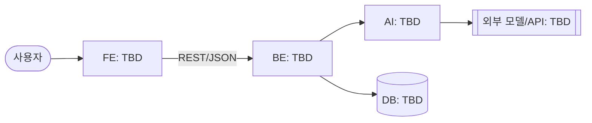

# 요구사항 명세 (SRS)

> 팀이 합의한 "무엇을 만드는가"이자 개발의 기준선. 유즈케이스(UC)에서 기능 요구사항(FR)을 뽑고, FR에서 데모 시나리오와 task를 뽑아 개발을 진행한다.
> ID는 커밋·PR·task 파일이 참조하므로 한 번 붙이면 바꾸지 않는다 (삭제는 ~~취소선~~ + 사유). 번호가 비는 것은 삭제의 흔적이지 누락이 아니다.
> 대회 규칙과 배점은 [`hackathon.md`](hackathon.md), 모듈별 상세 설계는 [`design/`](design/README.md). 이 문서는 팀 합의 후에만 바꾼다.

- **상태**: 초안 / 합의됨 (YYYY-MM-DD)
- **프로젝트명**: TBD
- **한 줄 소개**: TBD — "누가 / 무엇 때문에 / 어떻게 나아지는가"가 한 문장에 들어가야 한다.

| 종류 | 형식 | 예 |
| --- | --- | --- |
| 유즈케이스 | `UC-NN` | `UC-01` |
| 기능 요구사항 | `FR-NNN` | `FR-002` (UC와 무관한 연번. 소속 UC는 §4의 UC 제목으로 나타낸다) |
| 비기능 요구사항 | `NFR-<분류>-<순번>` | `NFR-PER-01` |

NFR 분류: `PER` 성능 · `SEC` 보안 · `REL` 신뢰성 · `USA` 사용성 · `OPS` 배포·운영

## 1. 개요

### 1.1 문제와 대상 사용자

- **누구**: 클라우드 비용을 내지 않고 프로젝트를 배포하고 싶은 학생, 프로젝트 과목이 끝난 뒤에도 서비스를 계속 운영하고 싶은 학생
- **지금 하는 방식**: Vercel, AWS, Cloudflare 등 상용 클라우드에 직접 배포하고, 무료 한도를 넘으면 비용을 직접 낸다.

| 문제 | 근거 (숫자 · 인터뷰 · 기사 · 직접 관찰) | 출처 |
| --- | --- | --- |
| 클라우드 비용과 크레딧이 부담된다 | TBD (설문 결과) | 구글폼 설문조사(학과 대상) |
| 학교 컴퓨팅 자원이 남는다 | 실습실 PC는 하루 24시간 중 수업 시간(TBD시간)에만 쓰인다. 수업 중에도 개인 노트북 대신 실습실 PC를 쓰는 학생은 TBD%뿐이다. | 직접 체크 |
| 프로젝트 과목은 배포에서 끝난다 | 결과물을 배포하는 데서 끝나고, 배포 이후의 운영은 다루지 않는다 | |

근거 출처는 [`ai-scope.md`](ai-scope.md) §4에도 올린다 (발표 부록).

### 1.2 해결 방법

- 학교 실습실의 유휴 PC를 k3s 클러스터로 묶어, 학생이 자기 GitHub 레포를 배포하고 운영할 수 있는 플랫폼을 제공한다.
- 배포 전에는 AI가 코드와 설정의 보안 위험을 검토하고, 운영 중에는 지표 이상의 원인을 AI가 분석해 알린다.
- 배포 이후 운영까지 학교 자원에서 이어 가, 수업과 AI 부트캠프의 실습·수업 자원으로 쓴다.

### 1.3 AI 동료의 역할 경계

주제 "AI는 동료가 될 수 있을까?"에 대한 우리 답. **AI가 하는 일과 사람이 결정하는 일**을 가른다.

| 상황 | AI가 하는 일 | 사람이 하는 일 / 결정 | 상태 |
| --- | --- | --- | --- |
| 배포 전 보안 위험 검토 | 배포할 레포의 코드와 설정에서 보안 위험(비밀키 노출, 과한 공개 권한 등)을 찾아 근거와 함께 알린다 | 학생이 지적을 보고 고치거나, 반박 의견을 남기고 배포를 진행한다 | |
| 운영 중 지표 이상 발생 | 감지된 이상의 원인을 추정해 쉬운 말로 설명하고, 다음 행동을 제안하는 알림을 보낸다 | 알림을 보고 재시작·중단 등 조치를 정한다 | 확정 |
| ~~정적 사이트를 배포한다~~ | ~~레포가 정적 사이트인지 판별해 Cloudflare R2에 올린다~~ | | 폐기 |
| 정적 사이트를 배포한다 | 레포가 정적 사이트인지 판별해 교내 클러스터에 Pod로 배치한다 | | 보류 |
| 동적 서비스를 배포한다 | 레포가 동적 서비스인지 판별해 교내 클러스터에 배치한다 | | 보류 |
| (시간이 남으면 추가) 동적 서비스를 배포하는데 교내 노드가 모두 꺼져 있다 | 클라우드 VM에 배치한다 | | 보류 |

정적 사이트를 외부 스토리지에 올리는 안은 **폐기**했다. 결과물을 교내 밖에 두면 "교내 유휴 자원으로 돌린다"는 강점이 사라진다. 정적 사이트도 동적 서비스와 같이 교내 클러스터에서 띄운다. 교내 밖에 두는 것은 빌드 결과 이미지와 페일오버용 볼륨 사본뿐이다 ([시스템 아키텍처](system-architecture.drawio.svg) 참고).

### 1.4 이미 있는 것과의 차이

| 이미 있는 것 | 한계 | 우리는 |
| --- | --- | --- |
| 상용 클라우드 (AWS, Vercel, Cloudflare) | 학생 개인이 비용을 부담하고, 무료 범위에는 한도가 있다 | 학생 서비스는 학교 유휴 PC에서 실행돼 학생이 비용을 내지 않는다. 학교가 지원하면 실행 비용은 전기료 수준이고, 외부 클라우드에는 빌드와 플랫폼 서버만 둔다. 교내 프로젝트와 해커톤(우왕톤 포함)에서 학생이 저렴하게 배포·운영한다 |
| 상용 AI 배포 보조 (Vercel Agent, AWS Security·DevOps Agent) | 유료이고 개발자·기업을 대상으로 한다 | 학생이 따로 설정하지 않아도 모든 배포에 배포 전 검토와 운영 중 이상 분석이 붙는다. 외부 LLM API 위에 검토 하네스와 시스템 프롬프트를 직접 설계한다 |

### 1.5 범위

개발 마감([대회 일정](hackathon.md))까지 완성할 MVP 범위. 기능 단위의 정의는 §3 UC가 한다.

- 학생이 GitHub URL로 배포를 요청하면 외부 플랫폼 서버가 이미지를 빌드하고, 교내 워커 노드가 그 이미지를 실행한다.
- 학교가 실습실의 남는 PC를 빌려주지 않으면 팀원의 남는 노트북으로 워커 노드를 구성한다.
- 워커 노드 1대에는 학생 서비스를 1개만 배치한다 (다른 워커 노드 서비스의 레플리카는 제외).
- 배포 전에 외부 LLM API로 레포의 코드와 설정을 검토한다. 검토 하네스는 우리가 만든다.
- 운영 중 지표 이상이 감지되면 외부 LLM API로 원인과 다음 행동을 분석해 알린다.
- 워커 노드가 꺼지면 그 노드에서 실행 중이던 이미지의 레플리카가 다른 워커 노드에서 실행되고, 사용자는 기존 entry point로 계속 접속한다.
- 플랫폼 서버는 우리 웹의 요청을 받아 리더 노드에 배포를 지시한다. 어느 워커 노드에 배치할지는 리더 노드가 고른다.
- 우리 웹은 공개 URL로 접속할 수 있다.

### 1.6 범위 밖

MVP에서 만들지 않기로 한 것과 이유. 심사 Q&A에서 "왜 이건 없나요?"에 대한 답이 된다. 만들 것은 §3 UC가 정의한다.

- 페일오버는 무중단·무손실을 보장하지 않는다. 레플리카로 넘어가는 동안 접속이 잠시 끊길 수 있고, 마지막 볼륨 사본 이후의 데이터는 잃을 수 있다.
- 리더 노드가 죽었을 때 다른 노드를 리더로 승격하지 않는다. 스플릿 브레인 방지까지 만들기에는 기간이 부족해 리더 노드는 단일 장애점으로 둔다.
- 교내 노드는 24시간이 아니라 학교가 허락한 시간에만 클러스터에 참여한다. 수업과 자원을 나눠 쓰는 스케줄링은 학교 협의가 필요하고 기간 안에 만들 수 없어 하지 않는다.

### 1.7 용어

| 용어 | 정의 |
| --- | --- |
| 플랫폼 서버 | 외부 클라우드에서 도는 우리 백엔드. 배포 요청 접수, AI 검토, 빌드, 리더 노드에 배포 지시를 맡는다 |
| 리더 노드 | k3s 컨트롤 플레인을 돌리는 교내 PC 1대. 워커 노드 선택(스케줄링)과 Ingress를 맡는다 |
| 워커 노드 | 학생 서비스를 실행하는 교내 PC. 학교가 빌려주지 않으면 팀원 노트북으로 대신한다 |
| 레플리카 | 같은 이미지를 다른 워커 노드에서 실행하는 복제본. 원래 노드가 꺼지면 트래픽을 넘겨받는다 |
| 볼륨 사본 | 워커 노드의 로컬 볼륨을 외부 오브젝트 스토리지에 올려 둔 복사본. 레플리카가 이어받을 때 여기서 데이터를 받는다 |
| entry point | 사용자가 학생 서비스에 접속하는 주소. 레플리카로 넘어가도 바뀌지 않는다 |
| 검토 하네스 | LLM API에 레포 내용을 넘기고 결과를 받는 우리 코드 전체. 입력 구성, 시스템 프롬프트, 결과 형식, 실패 처리를 포함한다 |

## 2. 시스템 구성

경계(누가 누구와 무엇을 주고받는가)만 여기서 고정한다. 모듈 하나의 내부 설계는 [`design/`](design/README.md)에 구현 직전에 쓴다. 스택은 회의에서 정한 뒤 [`adr/`](adr/README.md)에 남긴다.

### 2.1 아키텍처

스택이 정해지면 TBD를 채운다.

### 2.2 컴포넌트 책임

| 컴포넌트 | 책임 | 하지 않는 것 |
| --- | --- | --- |
| FE | | |
| BE | | |
| AI | | |

"하지 않는 것"을 적어 두면 두 곳이 같은 일을 하거나 아무도 안 하는 일이 줄어든다. 담당자는 여기 쓰지 않는다 (task 파일의 `Owner`와 Notion 칸반이 기준).

### 2.3 외부 의존과 가정

| 의존 | 용도 | 제약 (비용 · 속도 · 키 · 사용 한도) |
| --- | --- | --- |
| | | |

여기 적은 AI 모델·외부 API·데이터셋은 같은 커밋에서 [`ai-scope.md`](ai-scope.md)에도 올린다.

### 2.4 인터페이스

FE가 BE를, BE가 AI를 기다리지 않도록 **요청·응답 모양을 먼저 고정**한다. 여기서는 그룹 단위만 정하고, 엔드포인트별 요청·응답은 [`design/api.md`](design/api.md)에 쓴다.

| 그룹 | 방향 | 주고받는 데이터 | 관련 FR |
| --- | --- | --- | --- |
| | FE → BE | | |
| | BE → AI | | |

공통 규칙:

- 오류 응답: `{ "error": { "code": "STRING", "message": "사람이 읽는 설명" } }`
- 시간: ISO 8601, UTC
- AI 호출 실패 시 사용자에게 보이는 동작은 [NFR-REL-01](#5-비기능-요구사항)에서 정한다.

### 2.5 데이터 모델

| 엔티티 | 핵심 필드 | 설명 |
| --- | --- | --- |
| | | |

### 2.6 배포

| 컴포넌트 | 배포처 | URL | 환경 변수 |
| --- | --- | --- | --- |
| FE | | | |
| BE | | | |

비밀값은 배포처 환경 변수에만 둔다. 여기에는 **변수 이름만** 적는다 (`.env.example`과 맞춘다).

## 3. 유즈케이스

### 3.1 액터

| 액터 | 정의 | 관련 UC |
| --- | --- | --- |
| | | |

### 3.2 유즈케이스 목록

**P0 = 데모 경로.** 시연 영상과 본선 발표에서 실제로 돌아가야 하는 UC만 P0이다. 우선순위는 UC 단위로 정하고, FR은 UC의 우선순위를 따른다 (한 UC에 P0과 P1이 섞이면 UC를 쪼갠다). P0이 모두 동작하기 전에는 P1을 시작하지 않는다.

| ID | 유즈케이스 | 액터 | 우선순위 | AI 관여 |
| --- | --- | --- | --- | --- |
| UC-01 | | | P0 | 예/아니오 |
| UC-02 | | | P0 | |
| UC-03 | | | P1 | |

### 3.3 시나리오

UC마다 아래 형식으로 쓴다. 문장은 짧게, 한 줄에 동작 하나.

#### UC-01 유즈케이스명

- **액터**:
- **사전 조건**:
- **기본 흐름**:
  1.
  2.
- **대안·예외 흐름**:
  - E1. 조건 →
  - AI가 끼는 UC는 AI 호출 실패·지연 흐름을 하나 적는다.
- **결과**:

## 4. 기능 요구사항

UC마다 FR을 뽑는다. 한 문장에 하나, 검증 가능하게 쓴다 ("시스템은 …한다"). 확인은 §6 데모 시나리오와 테스트로 한다.

### UC-01 유즈케이스명

| ID | 요구사항 | AI 관여 |
| --- | --- | --- |
| FR-001 | 시스템은 …한다. | 예/아니오 |
| FR-002 | | |

## 5. 비기능 요구사항

해커톤에서는 데모와 심사에 영향을 주는 것만 적는다.

| ID | 요구사항 | 확인 방법 |
| --- | --- | --- |
| NFR-OPS-01 | 배포 URL이 심사 종료([대회 일정](hackathon.md))까지 접속 가능 | 시크릿 창 접속 |
| NFR-PER-01 | AI 응답 지연 TBD초 이내 (시연에서 기다리지 않을 정도) | 시연 경로에서 측정 |
| NFR-SEC-01 | API 키 등 비밀값이 저장소에 없음 | 저장소 검색 |
| NFR-REL-01 | AI 호출이 실패하면 TBD(재시도 버튼? 사람에게 넘기기?)를 사용자에게 보여준다. 그럴듯한 값으로 조용히 대체하지 않는다 ([`conventions.md`](conventions.md) F-1) | 일부러 실패시켜 확인 |

## 6. 데모 시나리오

시연 영상(5분)과 발표의 뼈대. 각 단계는 P0 UC 하나 이상에 대응한다.

| # | 사용자 행동 | 시스템 반응 | UC / FR |
| --- | --- | --- | --- |
| 1 | | | UC-01 / FR-001 |
| 2 | | | |

## 7. 열린 질문

결정이 필요한 것. 결정되면 이 표에서 지우고 본문이나 ADR에 반영한다.

| 질문 | 누가 정하나 | 기한 |
| --- | --- | --- |
| | | |
